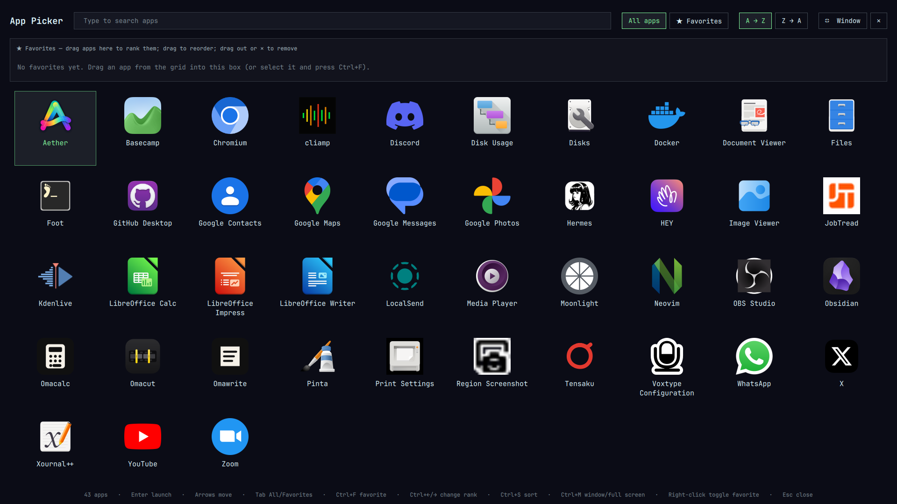

# Omarchy App Picker

A full-screen app launcher for [Omarchy](https://omarchy.org). It shows every
app from the Omarchy Apps menu as a grid of icons, lets you sort and search
them, and keeps a ranked list of favorites you build by drag and drop.



**Version:** 1.0.1 · **Plugin id:** `mulcahyio.app-picker` · **License:** MIT · **Contact:** dev@mulcahy.io

## Features

- **Full screen or windowed.** Opens full screen. One click (or Ctrl+M)
  switches to a large centered window. It opens on the screen you're on and
  fits that screen's size, orientation and scale.
- **Symmetrical grid.** Columns are worked out from the screen width and
  divide it evenly, so the grid stays balanced on any monitor.
- **Icons and names**, from the same app list as the Omarchy Apps menu: same
  apps, same icons, same hidden-app rules, same launch behaviour.
- **Sort A → Z or Z → A.**
- **Type to search**, using the Apps menu's matching.
- **Ranked favorites.** Drag an app into the Favorites box; where you drop it
  sets its rank (1, 2, 3 …). Drag to reorder, drag out or click ✕ to remove.
  A Favorites view shows only your favorites, in rank order.
- **Bar icon** next to the Omarchy icon, and a **keybinding** (Super + A by
  default).
- Follows your Omarchy theme.

The regular Omarchy Apps menu (Super + Alt + Space) is not changed.

## Requirements

- Omarchy 4.0 or later (uses the Omarchy shell plugin system).
- Tested on Omarchy 4.0.4, Hyprland 0.56.2, Quickshell 0.3.1.
- `git` and `jq` (both come with Omarchy).

## Install

```bash
git clone https://github.com/mulcahyio/omarchy-app-picker.git
cd omarchy-app-picker
./install.sh
```

The installer checks your system, installs the plugin in
`~/.config/omarchy/plugins/mulcahyio.app-picker/`, puts its icon after the
Omarchy icon, adds Super + A (without overriding a key you already use), and
restarts the Omarchy shell. Running it again is safe.

The **[Install Guide](docs/INSTALL.md)** covers access to the private
repository, installer options (`--key`, `--force-key`, `--no-keybinding`,
`--no-restart`, `--yes`), installing a specific version, installing with
`omarchy plugin add` or from a zip, checking the install, updating,
uninstalling and troubleshooting.

## Using it

### Mouse

| Action | Result |
|---|---|
| Click an app | Launch it |
| Right-click an app | Add to / remove from favorites |
| Drag an app into the Favorites box | Add it at the rank where you drop it |
| Drag a favorite within the box | Change its rank |
| Drag a favorite out of the box, or click its ✕ | Remove it from favorites |
| All apps / ★ Favorites buttons | Switch between all apps and favorites only |
| A → Z / Z → A buttons | Sort order (All apps view) |
| Window / Full screen button | Switch window mode |
| Click outside the window (window mode) or ✕ | Close |

### Keyboard

| Key | Result |
|---|---|
| Type | Search |
| Backspace / Ctrl+Backspace | Delete a character / clear the search |
| Arrows, Page Up/Down, Ctrl+Home/End | Move the selection |
| Enter | Launch the selected app |
| Tab | Switch All apps / Favorites |
| Ctrl+F | Add or remove the selected app as a favorite |
| Ctrl+← / Ctrl+→ | Move the selected favorite up or down one rank |
| Ctrl+S | Toggle A → Z / Z → A |
| Ctrl+M | Toggle full screen / window |
| Esc | Clear the search, or close |

### Favorites and settings

Favorites, sort order, view and window mode are saved in
`~/.local/state/omarchy-app-picker.json`. Favorites are stored as desktop-entry
ids. An app that is uninstalled drops out of the list.

## Update

```bash
omarchy plugin update mulcahyio.app-picker
omarchy restart shell
```

A shell restart is needed because the shell keeps the loaded plugin in memory.
See the [Install Guide](docs/INSTALL.md#5-update).

## Uninstall

```bash
~/.config/omarchy/plugins/mulcahyio.app-picker/uninstall.sh
```

This disables the plugin, removes the bar icon and the keybinding block,
deletes the plugin folder and restarts the shell. Favorites and settings are
kept; add `--purge` to remove them too.

## Troubleshooting

| Problem | Fix |
|---|---|
| Keybinding does nothing | `hyprctl binds \| grep -i "app picker"`; if missing, re-run `./install.sh` (or pick a free key with `--key "MODS + KEY"`). Run `hyprctl configerrors`. |
| Bar icon missing | `omarchy plugin list` should show `mulcahyio.app-picker enabled`. If not: `omarchy plugin enable mulcahyio.app-picker --section left --after omarchy.menu`. |
| Changes to the plugin files don't show | Run `omarchy restart shell`. |
| Some app is missing | The picker shows what the Omarchy Apps menu shows. Apps hidden there (NoDisplay, OnlyShowIn, Omarchy's hide list) are hidden here too. |

More in the [Install Guide](docs/INSTALL.md#8-troubleshooting).

## Files

| File | Purpose |
|---|---|
| `manifest.json` | Omarchy plugin manifest (id, version, entry points) |
| `AppPicker.qml` | The picker window |
| `BarWidget.qml` | The bar icon |
| `install.sh` / `uninstall.sh` | Installer and uninstaller |
| `LICENSE` | MIT License |
| `CHANGELOG.md` | Full release history |
| `docs/INSTALL.md` | Install Guide |
| `docs/ARCHITECTURE.md` | Architecture: components, Omarchy integration, data, flows, design decisions |
| `docs/DEVELOPMENT.md` | Development guide: checks, testing, releasing |
| `docs/screenshot.png` | Screenshot |

## Author and license

Developed by Patrick Mulcahy · dev@mulcahy.io

Released under the [MIT License](LICENSE): you may use, copy, change and share
it freely, as long as the copyright and license notice stay with it. It comes
with no warranty.
