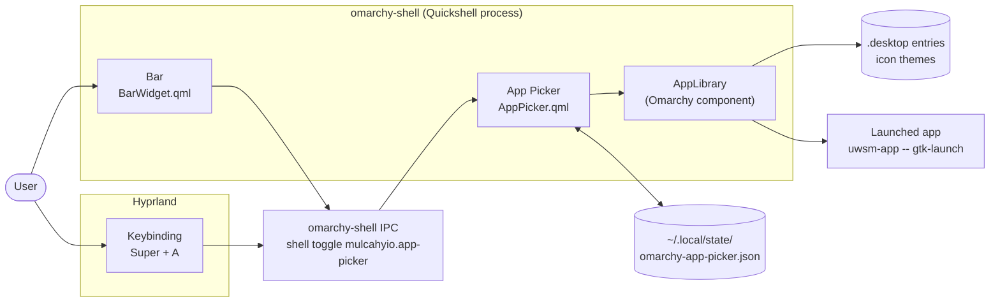
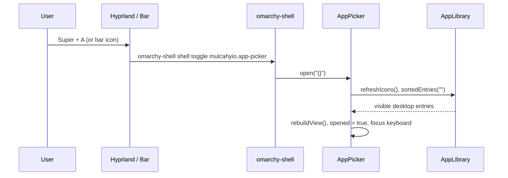
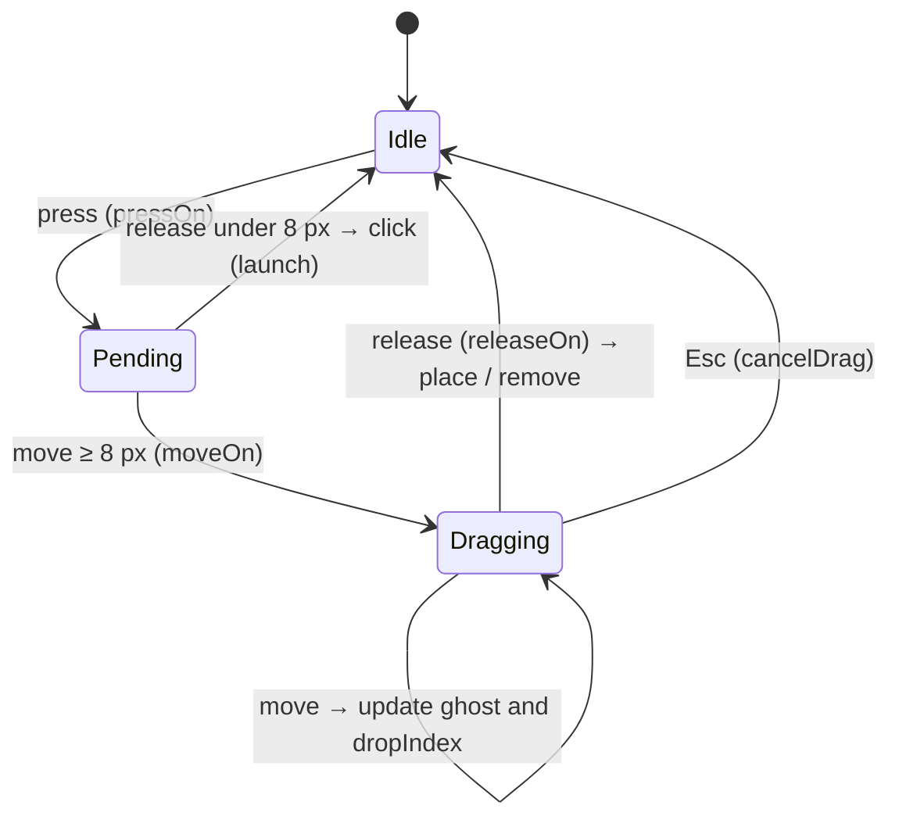

# Omarchy App Picker — Architecture

| | |
|---|---|
| **Product** | Omarchy App Picker |
| **Version** | 1.0.2 |
| **Plugin id** | `mulcahyio.app-picker` |
| **Developed by** | Patrick Mulcahy · dev@mulcahy.io |
| **License** | MIT |
| **Target platform** | Omarchy 4.x (tested on 4.0.4), Hyprland 0.56, Quickshell 0.3.1, Qt 6 |

## 1. Purpose and scope

The App Picker is a full-screen application launcher for Omarchy. It shows the
same applications as the Omarchy Apps menu, as a grid of icons and names, with
A → Z / Z → A sorting, type-to-search, and a ranked list of favorites that the
user builds by drag and drop.

It is delivered as an **Omarchy shell plugin** plus an installer. It does not
modify any Omarchy system files; everything it adds lives in the user's home
directory and can be removed with the uninstaller.

This document describes how the plugin is structured, how it integrates with
Omarchy, the main runtime flows, the data it stores, and the design decisions
behind it. Day-to-day development, testing and releasing are covered in
[DEVELOPMENT.md](DEVELOPMENT.md); installation in [INSTALL.md](INSTALL.md).

## 2. System context



Omarchy runs its bar, menus, notifications and overlays inside one
long-running Quickshell process, `omarchy-shell`. The shell discovers plugins
from two places:

| Location | Owner |
|---|---|
| `/usr/share/omarchy/shell/plugins/` | Omarchy (first-party, read-only) |
| `~/.config/omarchy/plugins/<id>/` | User (third-party) — the App Picker lives here |

A plugin is enabled when its id appears in `~/.config/omarchy/shell.json`.
For a bar widget that means an entry in the bar layout.

## 3. Components

| File | Kind | Responsibility |
|---|---|---|
| `manifest.json` | Plugin manifest | Declares id, version, the two entry points, `keepLoaded`, and bar-widget metadata (default section `left`) |
| `AppPicker.qml` | `menu` entry point | The picker window: app list, grid, search, sorting, favorites, drag and drop, keyboard handling, saved state |
| `BarWidget.qml` | `bar-widget` entry point | The grid icon in the bar; left click toggles the picker |
| `install.sh` | Installer | Requirement checks, installs the plugin as a git checkout, enables it, places the bar icon, adds the keybinding, restarts the shell |
| `uninstall.sh` | Uninstaller | Reverses the installer; keeps favorites unless `--purge` |

External components the plugin depends on:

| Dependency | Provided by | Used for |
|---|---|---|
| `qs.services` → `AppLibrary` | Omarchy shell (`/usr/share/omarchy/shell/services/`) | Desktop entries, hidden-app rules, search ranking, icon lookup, launching |
| `qs.Commons` → `Style`, `Color` | Omarchy shell | Fonts, spacing scale, theme colours (`Color.menu.*`) |
| `qs.Ui` → `BarWidget`, `WidgetButton` | Omarchy shell | Bar icon rendering and click handling |
| `Quickshell`, `Quickshell.Io`, `Quickshell.Wayland` | Quickshell | `PanelWindow` layer surface, `FileView` file I/O |
| `omarchy-shell` IPC | Omarchy | Opening, closing, enabling |
| `omarchy plugin enable/disable/validate` | Omarchy | Installer and uninstaller |
| `hyprctl`, `~/.config/hypr/bindings.lua` | Hyprland / Omarchy | Keybinding |

## 4. Runtime structure

`AppPicker.qml` builds this object tree once, when the shell loads the plugin:

```
Item (root)                         plugin object; open() / close() / dismiss()
├── AppLibrary (ownLibrary)         private copy of Omarchy's app library
├── FileView (stateFile)            ~/.local/state/omarchy-app-picker.json
├── Connections                     appsChanged → rebuildAll()
└── PanelWindow (panel)             Wayland layer surface, Overlay layer, all edges
    ├── Rectangle                   background (opaque full screen / scrim in window mode)
    ├── MouseArea                   click outside the card → dismiss
    └── Rectangle (card)            full screen, or 72 % × 78 % window
        ├── Item (keyCatcher)       keyboard focus, handleKey()
        ├── Item (header)           title, search box, view / sort / mode / close buttons
        ├── Rectangle (favBox)      Favorites ranking box
        │   └── Flow (favFlow)      favorite chips (Repeater), insertion marker
        ├── Item (gridArea)
        │   └── GridView (grid)     app tiles (icon, name, rank badge)
        ├── Text (footer)           app count and key hints
        └── Item (dragLayer)        floating copy of the app being dragged
```

`keepLoaded: true` in the manifest keeps this tree alive between opens: the
app list, icon index and saved state are ready, so the window appears
immediately. Opening and closing only toggle `opened`, which drives the
window's `visible`.

## 5. Integration contracts

### 5.1 Shell → plugin

When the shell loads `AppPicker.qml` it injects properties the root declares,
and calls lifecycle functions:

| Contract | Direction | Behaviour |
|---|---|---|
| `shell`, `manifest`, `omarchyPath` | shell → plugin | Scoped shell API, public manifest, Omarchy path |
| `open(payloadJson)` | shell → plugin | Reset search and drag, refresh icons, rebuild the list, show the window, take keyboard focus |
| `close()` | shell → plugin | Cancel any drag, hide the window |
| `opened` | plugin → shell | Read by the shell to answer "is it open?" for `toggle` |

### 5.2 Plugin → shell

| Call | Purpose |
|---|---|
| `shell.hide("mulcahyio.app-picker")` | Used by `dismiss()` (Esc, launch, ✕, click outside) so the shell's open state matches the plugin's |

### 5.3 IPC (keybinding, bar icon, scripts)

```bash
omarchy-shell shell toggle mulcahyio.app-picker      # open if closed, close if open
omarchy-shell shell summon mulcahyio.app-picker '{}' # open
omarchy-shell shell hide   mulcahyio.app-picker      # close
```

The bar icon calls the same `toggle` through the bar API (`bar.run(...)`),
exactly as the Omarchy icon toggles the Omarchy menu.

## 6. Data model

### 6.1 App record

Built from each `AppLibrary` entry:

| Field | Source | Example |
|---|---|---|
| `id` | Desktop-entry id | `org.gnome.Nautilus` |
| `name` | `AppLibrary.entryName()` | `Files` |
| `icon` | Desktop-entry `Icon=` | `org.gnome.Nautilus` |
| `subtext` | `AppLibrary.entrySubtext()` | generic name / comment |

### 6.2 Derived lists

| Property | Contents |
|---|---|
| `allApps` | Every visible app, in AppLibrary order |
| `favoriteApps` | Installed favorites in rank order |
| `favoriteRanks` | `id → rank` map, used for badges |
| `apps` | What the grid shows: Favorites view → `favoriteApps`; All apps → `allApps` sorted by name (`localeCompare`, case-insensitive, numeric, ascending or descending); then filtered by the search |

`rebuildView()` recomputes these. The grid model (`apps`) is replaced only
when the sequence of visible ids changes, so ranking a favorite in the All
apps view doesn't recreate the tiles or reset the scroll position.

### 6.3 Saved state

`~/.local/state/omarchy-app-picker.json`, written atomically on every change:

```json
{
  "version": 1,
  "sortOrder": "asc",
  "view": "all",
  "fullscreen": true,
  "favorites": ["org.gnome.Nautilus", "chromium"]
}
```

| Key | Values | Default |
|---|---|---|
| `sortOrder` | `asc` (A → Z), `desc` (Z → A) | `asc` |
| `view` | `all`, `favorites` | `all` |
| `fullscreen` | `true`, `false` (window mode) | `true` |
| `favorites` | Desktop-entry ids, rank 1 first | `[]` |

Unknown or invalid values fall back to the defaults. Favorites whose app is no
longer installed are hidden and dropped the next time favorites change.

## 7. Key flows

### 7.1 Open



### 7.2 Launch

Click, or Enter on the selection → `launch(app)` →
`AppLibrary.launch(id, name)` runs `uwsm-app -- gtk-launch <id>.desktop`
(with Omarchy's "Launching…" feedback if the window takes more than two
seconds) → `dismiss()` closes the picker through the shell.

### 7.3 Search and sort

Typing appends to `filterText`. `rebuildView()` asks
`AppLibrary.sortedEntries(filterText)` which apps match (the Apps menu's
ranking), then keeps the chosen alphabetical order among the matches. Sort
buttons and Ctrl+S change `sortOrder`, save state and rebuild.

### 7.4 Favorites by drag and drop

Drag and drop is implemented with plain `MouseArea`s instead of Qt's
`Drag` / `DropArea`, so one code path handles drags that start on a grid tile
or on a favorite chip:



- **`dropIndex`** is the insertion slot in the Favorites box, found by walking
  the chips in reading order (row, then x position against each chip's centre).
  `-1` means the pointer is outside the box.
- **On release:** inside the box → `placeFavorite(id, dropIndex)` (adds, or
  moves an existing favorite, adjusting for its old slot); a favorite released
  outside the box → `removeFavorite(id)`.
- The change is applied with `Qt.callLater`, after the release handler has
  returned, because it rebuilds the chips and the released chip may be one of
  them. Right-click and ✕ removal are deferred the same way.
- `preventStealing` stops the grid from flicking during a drag; the grid's
  `interactive` is off while dragging.

Keyboard equivalents use the same functions: Ctrl+F → `toggleFavorite()`,
Ctrl+← / Ctrl+→ → `moveFavorite()` (which keeps the selection on the moved
app in the Favorites view).

### 7.5 Selection and hover

The selection (`currentIndex`) moves with arrow keys, Page Up/Down and
Ctrl+Home/End. Hovering selects a tile only when the pointer has actually
moved (`pointerMoved()`); a tile recreated under a resting pointer doesn't
take the selection from the keyboard.

## 8. Layout and screen adaptation

| Aspect | Rule |
|---|---|
| Surface | `PanelWindow`, `WlrLayer.Overlay`, anchored to all edges, exclusive keyboard focus, `ExclusionMode.Ignore` so it covers the bar |
| Monitor | No screen is set, so Hyprland places it on the focused monitor and sizes it to that monitor |
| Full screen | Card fills the window, opaque background |
| Window mode | Card = max(72 % width, 560 px) × max(78 % height, 420 px), capped at the screen, centred over a dimmed scrim |
| Tile size | `target = clamp(min(cardW, cardH × 16/9) / 11, 110, 180)` logical px, scaled by Omarchy's spacing scale |
| Columns | `columns = floor(gridWidth / target)`; `cell = floor(gridWidth / columns)`; the grid is `cell × columns` wide and centred, so columns divide the width evenly |
| Icon | `clamp(cell × 0.42, 32, 88)` px, decoded at device pixel ratio for HiDPI |
| Theme | Colours from `Color.menu.*` (the theme's `[menu]` section) and `Color.accent`; fonts and spacing from `Style` |

On a 1920 × 1080 screen at scale 1 this gives 10 columns.

## 9. Installer architecture

`install.sh` is idempotent: running it again replaces the install rather than
adding to it.

| Step | Action | Safety |
|---|---|---|
| 1. Check | `omarchy`, `omarchy-shell`, plugin commands, `git`, `jq`, `hyprctl`; shell answers `ping`; Omarchy ≥ 4; manifest validates | Stops before changing anything |
| 2. Files | `git clone --no-checkout` of the checkout being run → checkout the exact commit on a branch (`main` for a tag checkout) that tracks GitHub → move into `~/.config/omarchy/plugins/mulcahyio.app-picker/`. A zip/tarball copy (no `.git`) is copied as is | Existing install replaced only after confirmation (or `--yes`); staging folder removed on failure |
| 3. Enable | `omarchy plugin enable mulcahyio.app-picker --section left [--after omarchy.menu]` | Skipped if already enabled |
| 4. Keybinding | Detect the current holder of the key with `hyprctl binds -j`; write a marked block to `bindings.lua` (or `bindings.conf` on older setups); `hyprctl reload`; report `hyprctl configerrors`; confirm the bind is live | Never overrides another binding unless `--force-key`; file backed up first (`*.bak.app-picker.<time>`); previous block replaced, not duplicated |
| 5. Load | `omarchy restart shell` | Skippable with `--no-restart` |

Keybinding block (Lua):

```lua
-- >>> omarchy-app-picker (managed by install.sh, removed by uninstall.sh)
o.bind("SUPER + A", "App Picker", "omarchy-shell shell toggle mulcahyio.app-picker")
-- <<< omarchy-app-picker
```

`uninstall.sh` hides and disables the plugin (which removes the bar entry
from `shell.json`), removes the marked block (backing up the file), deletes
the plugin folder, optionally deletes the state file (`--purge`) and restarts
the shell.

## 10. Design decisions

| # | Decision | Reason | Consequence |
|---|---|---|---|
| D1 | Build as an Omarchy shell plugin, not a separate app | Runs in the already-running shell: instant open, Omarchy theming, bar integration, no extra process | Depends on Omarchy's plugin API and QML modules |
| D2 | Use Omarchy's own `AppLibrary` | The picker must show exactly what the Apps menu shows, with the same hidden-app rules, icons and launch behaviour | Imports `qs.services`, an internal Omarchy module (see risks) |
| D3 | Create a private `AppLibrary` when the shell's facade is missing | On Omarchy 4.0.4 the app-library facade passed to third-party menu plugins is `null` | One extra icon-index scan in the shell; uses the facade automatically if a future Omarchy provides it |
| D4 | `keepLoaded: true` | Instant open; app list and icon index stay warm | Code changes need `omarchy restart shell` to load |
| D5 | Hand-built drag and drop | One path for tile → box, chip → chip and chip → out; full control of the insertion slot | More code than `DropArea`; verified by hand, no automated test |
| D6 | State in `~/.local/state`, not the plugin folder | The shell reloads a plugin when files in its folder change | State survives reinstall and uninstall (unless `--purge`) |
| D7 | Install as a git checkout | Same layout as `omarchy plugin add`, so `omarchy plugin update` and `git pull` work | Needs `git`; zip installs can't self-update |
| D8 | Marked keybinding block, never silent override | Users' existing bindings are respected; uninstall can remove exactly what was added | A taken key means no keybinding until the user picks one |
| D9 | Plugin id `mulcahyio.app-picker` | Namespaced by the GitHub account that publishes it, as Omarchy plugin marketplace IDs are permanent and globally unique | Installs from earlier personal builds must be removed first |

## 11. Constraints, risks and limitations

| Item | Detail | Mitigation |
|---|---|---|
| Internal Omarchy API | `qs.services.AppLibrary`, `qs.Commons`, `qs.Ui` and the plugin injection contract are Omarchy internals and may change in an Omarchy update | Compatibility is stated per release; check after Omarchy updates |
| Hot reload | The shell keeps the loaded plugin; edits apply only after `omarchy restart shell` | Installer restarts the shell |
| Drag and drop | No automated test (mouse drags can't be simulated on the test machine) | Tested by hand on 1.0.1 (add, reorder, remove); keyboard equivalents share the ranking code |
| Multi-monitor / HiDPI | Not yet tested | Layout uses logical pixels and the focused monitor |
| Favorites are per user | Stored in the user's state directory | Copy the state file to move favorites to another machine |
| Security | Plugins run unsandboxed in the shell process | The plugin only reads desktop entries and writes its own state file; it launches apps the same way the Apps menu does |

## 12. Compatibility

| Component | Tested | Notes |
|---|---|---|
| Omarchy | 4.0.4 | Requires the 4.x shell plugin system |
| Hyprland | 0.56.2 | Lua config (`bindings.lua`); `bindings.conf` supported but untested |
| Quickshell | 0.3.1 | |
| Displays | One 1920 × 1080 monitor, scale 1 | |
